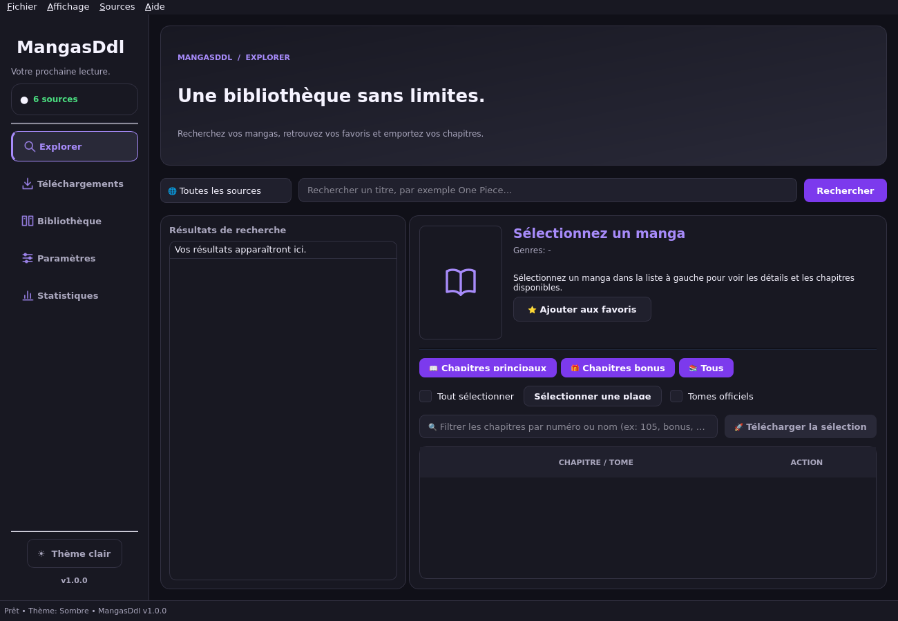
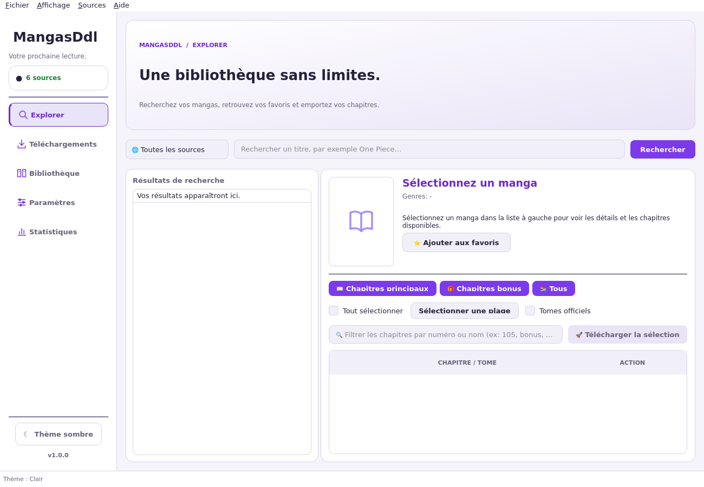

# MangasDdl 1.0

Application de bureau pour rechercher, lire et télécharger des mangas et webtoons. Interface Qt / PySide6, thèmes sombre et clair, bibliothèque de favoris et exports CBZ, PDF, EPUB ou images.



<details>
<summary>Voir le thème clair</summary>



</details>

## Démarrer

**Application portable Windows :** dans l'onglet [Actions](https://github.com/dorianskyfr/MangasDdl/actions), ouvrez une exécution réussie de « Tests et application portable », téléchargez l'artefact Windows, puis décompressez les deux archives. Lancez `MangasDdl.exe` en gardant le dossier `_internal` à côté. La disponibilité de l'artefact dépend de la réussite de la compilation Windows.

**Depuis le code source :** installez Python **3.12**, puis :

```sh
python -m venv .venv
# Windows
.venv\Scripts\activate
# Linux / macOS
source .venv/bin/activate

python -m pip install -r requirements-lock.txt
python main.py
```

Sur Windows, `Lancer_App.bat` prépare également l'environnement au premier lancement. Python doit être installé avec le lanceur `py` et la première installation nécessite Internet.

Sur Linux, Qt nécessite les bibliothèques graphiques du système. Sous Ubuntu, installez au besoin `libegl1 libopengl0 libxkbcommon0 libxcb-cursor0`.

## Utiliser l'application

1. Dans **Explorer**, recherchez un titre sur une source ou sur toutes les sources.
2. Sélectionnez un résultat pour charger ses détails et ses chapitres.
3. Ouvrez le lecteur, ajoutez le manga aux favoris ou choisissez les chapitres à télécharger.
4. Dans **Téléchargements**, suivez la progression, mettez en pause, annulez ou relancez une tâche en échec.
5. Dans **Paramètres**, choisissez votre dossier, votre format d'export et les domaines des sources.

La file traite deux chapitres ou tomes à la fois, avec 1 à 16 requêtes de pages par tâche. Les pages déjà présentes sont vérifiées avant une reprise. Un chapitre avec des pages manquantes ou un tome avec un chapitre manquant reste en échec ; les images sont conservées pour une nouvelle tentative. Une couverture indisponible n'empêche pas l'export des chapitres complets.

Le lecteur propose un affichage page par page et un défilement webtoon, avec quatre chargements simultanés au maximum. Un chapitre n'est marqué comme lu qu'après l'affichage de sa dernière page, ou après avoir atteint le bas du webtoon entièrement chargé.

## Données personnelles

Les préférences, favoris et historiques sont enregistrés dans le dossier utilisateur, indépendamment du dossier depuis lequel l'application est lancée :

- Windows : `%LOCALAPPDATA%\MangasDdl`
- Linux : `${XDG_DATA_HOME:-~/.local/share}/MangasDdl`
- macOS : `~/Library/Application Support/MangasDdl`

Les anciens fichiers présents à côté du code sont copiés à la première utilisation, sans suppression des originaux. La configuration personnelle n'est plus suivie par Git. `config.example.json` documente les options ; le dossier de téléchargement par défaut est `~/Downloads/MangaDownloader`. La variable `MANGASDDL_DATA_DIR` permet de choisir un autre dossier de données, notamment pour les tests.

## Sources et disponibilité

Anime-Sama, Crunchyscan / SushiScan, JapScan, UNekoScans, Scan-VF et MangaDex sont configurés. Leurs domaines, contenus et protections peuvent changer. **Paramètres → Tester les sources** effectue une vérification réseau sans bloquer l'interface. Les badges indiquent une source configurée, pas une disponibilité garantie.

Vérifications du 8 octobre 2026 dans l'environnement de développement : les recherches MangaDex et Anime-Sama renvoient des résultats ; les pages d'accueil de cinq sources répondent en HTTP 200 ; UNekoScans refuse l'accès en HTTP 403. Ces vérifications ne garantissent pas l'accès à chaque chapitre. Les correspondances de tomes peuvent aussi dépendre de métadonnées externes.

## Vérifier et compiler

```sh
python -m pip install -r requirements-dev.txt
python -m pytest -q
python scripts/build.py
```

Sous Linux sans affichage, utilisez `QT_QPA_PLATFORM=offscreen` pour les tests et la compilation. Le script compile l'application pour le système courant, vérifie son démarrage et crée une archive dans `dist/`. La CI exécute ces étapes sous Windows et Linux. Une compilation native macOS reste à valider sur macOS.

Les tests couvrent les exports, les images manquantes, la reprise, les paramètres invalides, la sauvegarde atomique, les chemins de fichiers, les réponses de recherche obsolètes, les tâches de fond, l'annulation, la file de téléchargement et les changements de mode du lecteur. Voir [CHANGELOG.md](CHANGELOG.md).

## Raccourcis

| Action | Raccourci |
| --- | --- |
| Explorer | Ctrl+F |
| Téléchargements | Ctrl+D |
| Bibliothèque | Ctrl+B |
| Paramètres | Ctrl+, |
| Ouvrir le dossier | Ctrl+O |
| Thème clair / sombre | Ctrl+T |
| Journal d'activité | Ctrl+L |
| Plein écran | F11 |
| Lecteur : précédent / suivant | ← / → / Espace |
| Lecteur : zoom / réinitialiser | Ctrl+plus / Ctrl+moins / Ctrl+0 |
